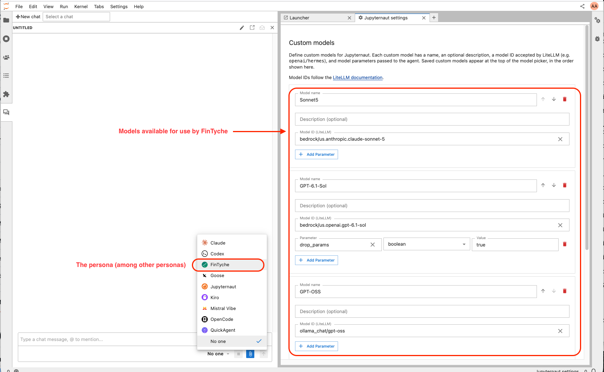
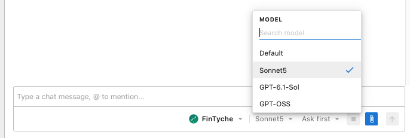
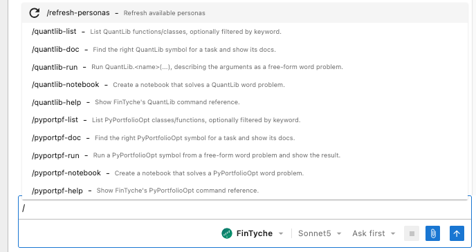
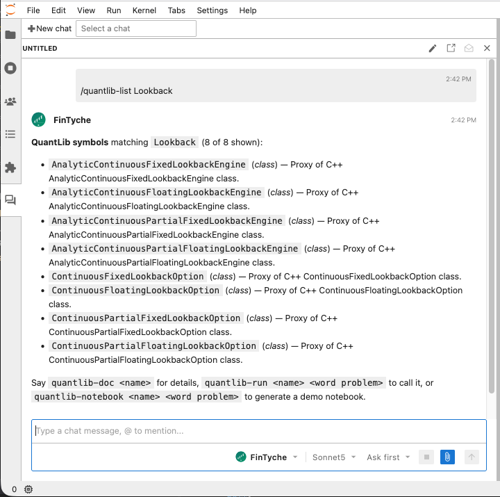
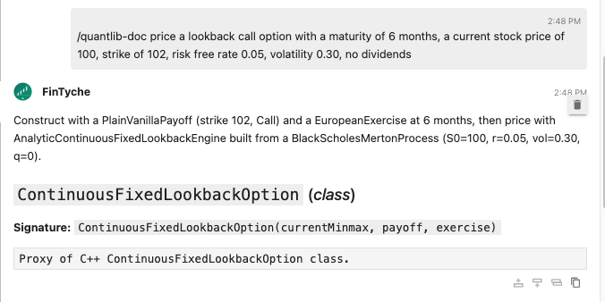
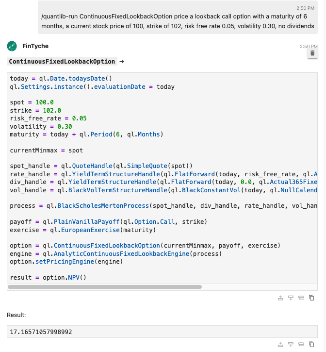

# ai-finance-persona-in-jupyter

> **Disclaimer.** FinTyche is sample code provided for educational and illustrative
> purposes only. It is not for use in production, and it is not financial,
> investment, tax, or legal advice. Prices, portfolios, and other outputs are
> produced by language-model-generated code and have not been checked for
> financial correctness, so verify every result independently before relying on
> it. Market data comes from Yahoo Finance through `yfinance` and is subject to
> Yahoo's terms. You are responsible for your own use of this software, the
> models you connect to it, and any decisions you make with its output.

**FinTyche** is a [Jupyter AI](https://github.com/jupyterlab/jupyter-ai) persona for quantitative finance. It follows the same architecture as [`jupyter-ai-quickagent`](https://github.com/srdas/jupyter-ai-quickagent) — a persona registered through the `jupyter_ai.personas` entry point and managed by [`jupyter-ai-persona-manager`](https://github.com/jupyter-ai-contrib/jupyter-ai-persona-manager) — except FinTyche is a single, fixed persona rather than an agent builder.

 Agentic AI offers a third leg of a stool that comprises (i) financial packages, (ii) Jupyter notebooks, (iii) agentic AI. Many financial libraries exist that are used in Jupyter notebooks already. Some popular ones are listed below. 

| Library | Primary Target Audience | Core Strengths | Limitations |
| --- | --- | --- | --- |
| **QuantLib** | Derivatives quants, fixed income engineers, risk managers | Institutional-grade yield curves, bond pricing, option engines, and underlying math optimizers | Lacks built-in high-level portfolio optimization routines (requires custom solver setup) |
| **PyPortfolioOpt** | Beginners, rapid prototyping, retail quants | Simple API, robust mean-variance, Black-Litterman, shrinkage estimators | Lacks advanced machine learning allocation methods or complex tail-risk constraints |
| **Riskfolio-Lib** | Institutional quants, academic researchers | 13+ convex risk measures (CVaR, EVaR, Drawdown), factor models, Hierarchical Risk Parity (HRP) | Steep learning curve, heavy dependency footprint |
| **skfolio** | Data scientists, ML engineers | Scikit-learn native API, model cross-validation, hyperparameter tuning, pipelines | Newer ecosystem compared to PyPortfolioOpt |
| **cvxpy** *(Base Solver)* | Quantitative developers, researchers | Complete mathematical freedom; build custom convex optimization problems from scratch | Requires low-level formulation of portfolio equations and constraint matrices |
| **PortfolioAnalytics** *(R Ecosystem)* | R-native quantitative analysts | Extremely mature, handles non-convex objectives, comprehensive backtesting | R-only (not natively integrated into Python quantitative pipelines) |

This repository builds a natural language workflow Persona into Jupyter AI, that enables users to price securities and undertake financial analyses mostly done by quants, without needing to know the innards of these libraries. We are implementing them one by one.

As of now, FinTyche gives you chat-native access to two libraries, each exposed through the same set of verbs (`list`, `doc`, `run`, `notebook`):

- **[QuantLib](https://www.quantlib.org/)** — the derivatives/fixed-income analytics library (the Python bindings published from [`lballabio/QuantLib`](https://github.com/lballabio/QuantLib) and [`lballabio/QuantLib-SWIG`](https://github.com/lballabio/QuantLib-SWIG)), driven by the `/quantlib-*` slash commands. A full reference manual is available: [QuantLib Python Cookbook](https://leanpub.com/quantlibpythoncookbook). The [extras](https://leanpub.com/s/1E4430B32F154217A4E0ABA48B593987.zip) that come with the cookbook provide several Jupyter notebooks with examples.
- **[PyPortfolioOpt](https://github.com/PyPortfolio/PyPortfolioOpt)** — the portfolio-optimization library (imported as `pypfopt`), driven by the `/pyportpf-*` slash commands. It covers mean-variance optimization (`EfficientFrontier`), Black-Litterman, Hierarchical Risk Parity, CVaR/CDaR/semivariance objectives, expected-returns and covariance estimators, and discrete allocation. See its [documentation](https://pyportfolioopt.readthedocs.io/en/latest/), [module index](https://pyportfolioopt.readthedocs.io/en/latest/py-modindex.html), and [general index](https://pyportfolioopt.readthedocs.io/en/latest/genindex.html).

Both libraries share a per-chat model picker — the same awareness-based mechanism used by [`jupyter-ai-acp-client`](https://github.com/jupyter-ai-contrib/jupyter-ai-acp-client) — for free-form quant-finance questions.

## Features

Two libraries — **QuantLib** and **PyPortfolioOpt** — are exposed through one
uniform set of verbs. QuantLib uses the bare verbs (`list`, `doc`, `run`,
`notebook`, `help`) and the `/quantlib-*` slash commands; PyPortfolioOpt uses the
`/pyportpf-*` slash commands (or the bare `pyportpf-list`, `pyportpf-doc`, …
spellings).

- **Function discovery** — `/quantlib-list [filter]` / `/pyportpf-list [filter]`
  enumerate every public class/function the library exposes, optionally filtered
  by keyword. For PyPortfolioOpt, submodule functions are surfaced as dotted
  names (e.g. `risk_models.sample_cov`, `expected_returns.mean_historical_return`).
- **Inline documentation** — `/quantlib-doc <word problem>` /
  `/pyportpf-doc <word problem>` describe what you want to do in plain English
  (e.g. `/pyportpf-doc maximize the Sharpe ratio of a stock portfolio`) and
  FinTyche uses the LLM to find the right symbol and show its signature and
  docstring. An exact symbol name still works directly (e.g. `doc VanillaOption`,
  `/pyportpf-doc EfficientFrontier`), as does just typing a bare QuantLib or
  PyPortfolioOpt symbol name (e.g. `Date`, `EfficientFrontier`).
- **Word-problem execution** — `/quantlib-run <name> <word problem>` /
  `/pyportpf-run <name> <word problem>` describe the task in plain English (e.g.
  `run Date the fifteenth of June 2025`, or `/pyportpf-run EfficientFrontier
  maximize the Sharpe ratio of AAPL, MSFT, GOOG, META`); FinTyche uses the LLM
  to write a short snippet around `<name>` — including any setup such as a
  pricing engine (QuantLib) or expected-returns/covariance estimation
  (PyPortfolioOpt) — runs it, and shows the code and its result, asking a
  follow-up question if something required is missing rather than guessing.
- **Notebook generation** — `…-notebook <name> <word problem> [as <filename>]`
  does exactly the same word-problem extraction as `run`, but writes the
  generated snippet into a ready-to-run `.ipynb` in your current workspace
  instead of replying inline.
- **You choose who runs the code** — when FinTyche resolves a word problem to a
  symbol, the **Running code** setting beside the model picker decides what
  happens next: *Ask first* (the default) offers to run it and waits for a
  **yes**, *Run automatically* runs it immediately, and *I'll run it myself*
  only shows the `run` command to use. Because generated code is `exec`'d (under
  restricted builtins), nothing runs unprompted unless you opt into
  *Run automatically*.
- **Conversational runs** — once a symbol is on the table you can just say
  **"run it"** (or "go ahead and run the model", "run it with 5% vol") instead of
  retyping `…-run <name> <word problem>`; FinTyche resolves it against the last
  symbol it picked, folding any extra detail into the word problem.
- **Slash commands** — `/quantlib-list`, `/quantlib-doc`, `/quantlib-run`,
  `/quantlib-notebook`, `/quantlib-help` and `/pyportpf-list`, `/pyportpf-doc`,
  `/pyportpf-run`, `/pyportpf-notebook`, `/pyportpf-help` are advertised for
  autocomplete in the chat input.
- **Per-chat model picker** — pick which LLM answers FinTyche's free-form quant-finance
  questions from a dropdown next to its name, independent of Jupyter AI's global chat model.
- **Quant analytics helpers** — `skills/quant_skills.py` ships `RiskAnalytics` (Sharpe, max
  drawdown, VaR), `AlphaFactors` (RSI, MACD), and `VectorizedBacktest` (SMA crossover) for direct
  import inside notebook cells.

## Example workflow

Start JupyterLab. The workflow below prices a **continuous fixed-strike lookback call option** end-to-end, without ever leaving the chat panel or writing any QuantLib code by hand. The task: *a lookback call with a 6-month maturity, spot 100, strike 102, risk-free rate 0.05, volatility 0.30, and no dividends.* Each step below shows the workflow.

### 1. Pick FinTyche as the persona

FinTyche installs as one more persona alongside Jupyternaut, QuickAgent, and any ACP-based agents you have. Select it from the persona dropdown at the bottom of the chat input, and every message you send is routed to FinTyche instead of the default assistant.



### 2. Choose the model that answers

FinTyche runs its own per-chat model picker, sitting right next to its name. The models offered here are the ones saved in Jupyter AI's **Custom models** settings (shown on the right above) — so you can point FinTyche at a hosted model such as Claude Sonnet, or a local one served through Ollama, independent of Jupyter AI's global chat model. If you don't pick one, FinTyche falls back to your configured Jupyternaut model.



Next to the model picker is a **Running code** setting, which decides who runs the code once FinTyche has worked out which symbol answers your question: **Ask first** (the default) offers and waits for your **yes**, **Run automatically** runs it straight away, and **I'll run it myself** only shows you the command. Generated code is executed with `exec` (under restricted builtins), so nothing runs unprompted unless you choose *Run automatically*.

### 3. Discover the commands

Typing `/` in the chat input surfaces FinTyche's slash commands with inline hints, so you never have to memorize the syntax: `/quantlib-list`, `/quantlib-doc`, `/quantlib-run`, `/quantlib-notebook`, and `/quantlib-help` for QuantLib, and `/pyportpf-list`, `/pyportpf-doc`, `/pyportpf-run`, `/pyportpf-notebook`, and `/pyportpf-help` for PyPortfolioOpt.



### 4. Find the right QuantLib symbol — `list`

Let's say we want to price a **lookback** option. A lookback option (or hindsight option) is a type of exotic financial derivative that allows the holder to "look back" over the life of the option and exercise it at the most favorable, optimal price the underlying asset achieved. Unlike standard ("vanilla") options, which only care about the asset price at expiration, a lookback option’s payoff depends on the absolute maximum or minimum price reached by the asset during the entire contract period. This eliminates market-timing risk, but it comes at the cost of a much higher upfront premium. For additional simple information about lookback options, see [Investopedia](https://www.investopedia.com/terms/l/lookbackoption.asp).

Start by narrowing down which QuantLib classes are relevant. `/quantlib-list Lookback` runs directly against the installed QuantLib package (no LLM call) and returns every public symbol whose name matches `Lookback` here, eight lookback option classes and their analytic pricing engines. 



### 5. Describe the task in plain English — `doc`

Rather than guess which of those eight symbols you need, describe the problem in words. `/quantlib-doc price a lookback call option with a maturity of 6 months, ...` asks the selected model to identify the most appropriate symbol — `ContinuousFixedLookbackOption` — and shows you its signature and docstring, plus a plain-language note on how to assemble it (a `PlainVanillaPayoff`, a `EuropeanExercise`, and an `AnalyticContinuousFixedLookbackEngine` built on a `BlackScholesMertonProcess`).



### 6. Price it — `run`

On the default **Ask first** setting you don't need to retype anything: having identified `ContinuousFixedLookbackOption` in step 5, FinTyche offers to run it, and replying **yes** (or **"run it"**) is enough. You can also hand the word problem to `run` explicitly, which is what the screenshot below shows. `run ContinuousFixedLookbackOption price a lookback call option with a maturity of 6 months, ...` asks the model to write a complete, runnable QuantLib snippet around that symbol — setting the evaluation date, building the flat term structures and Black-Scholes-Merton process, attaching the analytic lookback engine, and reading `.NPV()`. FinTyche executes it and shows both the generated code and the result: a price of **17.28**.



Note how FinTyche assembled the code needed to generate the final price, which required the use of multiple functions in QuanLib (not just one single function). QuantLib poses a steep learning curve, which FinTyche helps the user to bypass and get to a usage model very quickly. 

From here, swapping `run` for `notebook` writes the identical snippet into a ready-to-run
`.ipynb` in your workspace, so you can tweak inputs and re-run it interactively — turning a
one-line natural-language request into working, editable quant code.

## Architecture

```
┌─────────────────────────────────────────────────────────────┐
│                    JupyterLab Chat Interface                 │
│                     (Mention: @FinTyche)                   │
└───────────────────────────────┬───────────────────────────────┘
                                  │
                                  ▼
┌─────────────────────────────────────────────────────────────┐
│               Jupyter AI Persona: FinTychePersona           │
│   - Inherits BasePersona (jupyter_ai_persona_manager)         │
│   - Publishes a per-chat model picker (ModelConfiguration)    │
│   - Plus an execution-mode setting (who runs generated code)  │
│   - Falls back to Jupyternaut's configured model if none set  │
└───────────────────────────────┬───────────────────────────────┘
                                  │
                    ┌─────────────┴─────────────┐
                    ▼                             ▼
┌───────────────────────────────┐   ┌───────────────────────────────┐
│  quantlib_tools.py /            │   │        litellm chat            │
│  pyportfolioopt_tools.py        │   │  - free-form quant questions   │
│   (one shared backend API)      │   │  - `doc` word-problem → symbol │
│  - list_entries() / get_doc()  │   │  - `run`/`notebook` word-problem│
│  - has_symbol() / call_function()│  │    code extraction (follow-up) │
│  - run_snippet()/create_notebook()│ │  - library-specific prompts    │
│                                 │   │  - streamed via BasePersona    │
│                                 │   │    .stream_message()           │
└───────────────────────────────┘   └───────────────────────────────┘
                    │
        ┌───────────┴───────────┐
        ▼                       ▼
┌───────────────────┐   ┌───────────────────────────┐
│     QuantLib       │   │       PyPortfolioOpt        │
│ (built from        │   │   (imported as `pypfopt`)   │
│  QuantLib-SWIG)    │   │                             │
└───────────────────┘   └───────────────────────────┘
```

Each backend (see `_BACKENDS` in `backends.py`) bundles its introspection/execution
module, its `import ... as` alias, its slash-command prefix, and its two LLM system
prompts. Every command handler is written once and dispatched per backend, so both
libraries behave identically.

Everything FinTyche does with a message — routing, symbol resolution, code
generation and execution, pinned code, history, chat — lives in
`FinTycheCore` (`core.py`), which imports nothing from Jupyter. The persona
(`persona.py`) and the command line (`cli.py`) are two frontends that mix it in
and supply only their I/O, so both behave the same way.

## Installation

### Prerequisites

- Python >= 3.11
- [`uv`](https://docs.astral.sh/uv/) to create the virtual environment and install packages
  (a plain `pip install -e .` works too if you manage your own environment, but you'll need to
  install `jupyter-ai` and `jupyter-ai-jupyternaut` yourself first)

### Install FinTyche

```bash
git clone https://github.com/awslabs/ai-finance-persona-in-jupyter.git
cd ai-finance-persona-in-jupyter

uv venv --python 3.13
source .venv/bin/activate

uv pip install jupyter-ai
uv pip install jupyter-ai-jupyternaut

uv pip install -e .
```

This will:

1. Create and activate a Python 3.13 virtual environment.
2. Install [Jupyter AI](https://github.com/jupyterlab/jupyter-ai) v3 and
   [`jupyter_ai_jupyternaut`](https://github.com/jupyterlab/jupyter-ai) so FinTyche's free-form
   chat can fall back to your globally configured Jupyternaut model when no per-chat model is
   selected.
3. Install the FinTyche package and register `FinTychePersona` under the `jupyter_ai.personas`
   entry point group, pulling in its own dependencies: `jupyter_ai_persona_manager`, `litellm`,
   `QuantLib`, `PyPortfolioOpt`, `nbformat`, `pandas`, `numpy`, and `yfinance`.

Confirm the persona entry point is registered:

```bash
python -c "from importlib.metadata import entry_points; print([e.name for e in entry_points(group='jupyter_ai.personas')])"
```

You should see `fintyche` in the list.

### Start JupyterLab

```bash
cd ai-finance-persona-in-jupyter
source .venv/bin/activate
jupyter lab
```

**FinTyche** will appear alongside Jupyternaut, QuickAgent, and any other installed personas in
the persona dropdown. If you add or update personas later, run `/refresh-personas` in the chat
instead of restarting the server.

## Configuring the model picker

FinTyche keeps no model list of its own. Its chat-toolbar model picker offers the custom models you saved for Jupyternaut in Jupyter AI's **Settings > AI Settings** (read through Jupyternaut's `ConfigManager`; see `jupyter_ai_fintyche/models.py`), plus a **Default** row. Each entry is a [LiteLLM](https://docs.litellm.ai/) model ID, so any LiteLLM provider works, including Amazon Bedrock, OpenAI, Anthropic, and local models served through Ollama. To add a model to the picker, add it as a custom model in those settings.

If no model is selected, or the selected custom model has since been deleted, FinTyche uses the default chat model configured in **Settings > AI Settings**. If none is configured, FinTyche asks you to configure one.

Whichever model is selected must have its credentials available to LiteLLM, for example `OPENAI_API_KEY` or `ANTHROPIC_API_KEY` as environment variables, or your AWS configuration for `bedrock/...` models.

`list` runs directly against the installed library (`QuantLib` or `PyPortfolioOpt`) and never calls an LLM, as does `doc` when given an exact symbol name. `doc <word problem>`, `run`, and `notebook` call the LLM — `doc` to pick the right symbol, `run`/`notebook` to turn the word problem into a snippet (unless you invoke `run`/`notebook` with no word problem at all, e.g. `run Actual360` / `notebook Actual360`, which need nothing to extract and just call the symbol with no arguments).

## Usage

Mention `@FinTyche` in the Jupyter AI chat panel:

```
@FinTyche list swap
@FinTyche doc how do I price a European call option
@FinTyche run Date the fifteenth of June 2025
@FinTyche notebook VanillaOption price a European call, spot 100, strike 100, r 0.05, vol 0.20, maturing 25 Aug 2027 as call_demo
@FinTyche help
```

PyPortfolioOpt is driven the same way, through its `/pyportpf-*` commands (bare
`pyportpf-list`, `pyportpf-doc`, … spellings work too):

```
@FinTyche /pyportpf-list frontier
@FinTyche /pyportpf-doc how do I build a minimum-volatility portfolio
@FinTyche /pyportpf-run EfficientFrontier maximize the Sharpe ratio of a portfolio of AAPL, MSFT, GOOG, META
@FinTyche /pyportpf-notebook HRPOpt hierarchical risk parity over 10 tech stocks as hrp_demo
@FinTyche /pyportpf-help
```

Typing a bare QuantLib or PyPortfolioOpt symbol name also works as a documentation shortcut:

```
@FinTyche Date
@FinTyche EfficientFrontier
```

Anything that isn't a recognized command is answered as a quant-finance chat question by the
model currently selected in FinTyche's picker, for example:

```
@FinTyche Explain how a discounting swap engine prices a vanilla interest rate swap.
```

### Command reference

Both libraries share the same five verbs. QuantLib accepts the bare verbs
(`list`, `doc`, `run`, `notebook`, `help`) as well as its `/quantlib-*` slash
forms; PyPortfolioOpt is reached through its `/pyportpf-*` slash forms (or the
bare `pyportpf-list`, `pyportpf-doc`, … spellings — the bare verbs cannot be
shared between two libraries, so PyPortfolioOpt keeps its prefix).

**QuantLib**

| Command | Slash form | Description |
|---|---|---|
| `list [filter]` | `/quantlib-list` | List QuantLib functions/classes, optionally filtered by a keyword. |
| `doc <word problem>` | `/quantlib-doc` | Describe a task in plain text; FinTyche uses the LLM to find the most appropriate QuantLib symbol and shows its signature and docstring (plus a short note on companion classes). An exact symbol name (e.g. `doc VanillaSwap`) is shown directly without an LLM call. |
| `<name>` | — | Shortcut for `doc <name>` when `<name>` is a bare QuantLib symbol. |
| `run <name> <word problem>` | `/quantlib-run` | Describe the problem in free-form text; FinTyche uses the LLM to write a short QuantLib snippet built around `<name>` — including any setup such as a stochastic process and pricing engine — runs it, and shows the code and its result. This is what lets a single command actually *price* an instrument (e.g. `run VanillaOption "European call, spot 100, strike 100, r 0.05, vol 0.20, maturing 25 Aug 2027"`), not just construct it. `run <name>` with no text calls `QuantLib.<name>()` directly (no LLM needed) when it takes no arguments. |
| `notebook <name> <word problem> [as <filename>]` | `/quantlib-notebook` | Same word-problem extraction as `run`, but writes the generated QuantLib snippet into a ready-to-run notebook in the current workspace instead of replying inline. Asks the same follow-up questions when info is missing. `notebook <name>` with no word problem writes a notebook that calls `QuantLib.<name>()`. |
| `help` | `/quantlib-help` | Show the command reference. |

**PyPortfolioOpt**

| Command | Slash form | Description |
|---|---|---|
| `pyportpf-list [filter]` | `/pyportpf-list` | List PyPortfolioOpt classes/functions, optionally filtered by a keyword. Submodule functions are shown as dotted names (e.g. `risk_models.sample_cov`, `expected_returns.mean_historical_return`). |
| `pyportpf-doc <word problem>` | `/pyportpf-doc` | Describe a portfolio task in plain text; FinTyche uses the LLM to find the most appropriate PyPortfolioOpt symbol and shows its signature and docstring. An exact symbol name (e.g. `/pyportpf-doc EfficientFrontier`, or a dotted `risk_models.CovarianceShrinkage`) is shown directly without an LLM call. |
| `<name>` | — | Shortcut for documentation when `<name>` is a bare PyPortfolioOpt symbol (e.g. `EfficientFrontier`). QuantLib symbols take priority for this shortcut. |
| `pyportpf-run <name> <word problem>` | `/pyportpf-run` | Describe the problem in free-form text; FinTyche uses the LLM to write a short PyPortfolioOpt snippet built around `<name>` — including estimating expected returns and a covariance matrix, constructing the optimizer, solving for weights, and reading `portfolio_performance()` — runs it, and shows the code and result. When you don't supply price/returns data, real adjusted prices (and market caps, for Black-Litterman) are fetched with `yfinance`. Simulated data is used only when you ask for it or a fetch fails, and the result is then marked with a warning that it uses fake data. FinTyche shows the code it writes; `run it` reruns exactly that code, and a later request for the same symbol (including a fix after an error) edits it rather than starting over. |
| `pyportpf-notebook <name> <word problem> [as <filename>]` | `/pyportpf-notebook` | Same word-problem extraction as `pyportpf-run`, but writes the generated snippet into a ready-to-run notebook. `pyportpf-notebook <name>` with no word problem writes a notebook that calls `pypfopt.<name>()`. |
| `pyportpf-help` | `/pyportpf-help` | Show the command reference. |

### `run` and missing arguments

`run <name> <word problem>` sends your description, along with the symbol's signature and
docstring, to the model selected in FinTyche's picker and asks it to write a short QuantLib
snippet built around `<name>` that computes the answer and assigns it to a `result` variable.
Because it's a full snippet rather than a bare argument list, the model can perform the setup
that many QuantLib objects need before they're useful — for instance building a
`BlackScholesMertonProcess`, attaching an `AnalyticEuropeanEngine`, and reading `.NPV()` to
actually price an option. Simple constructor calls still work the same way (e.g.
`run Date 15, 6, 2025` becomes `result = ql.Date(15, 6, 2025)`).

If the model determines it doesn't have enough information to compute the answer, FinTyche
asks a clarifying question instead of guessing:

```
@FinTyche run Date the fifteenth of June
FinTyche: What year should the date use?
@FinTyche 2025
FinTyche: **`Date(15, 6, 2025)`** → ...
```

Your next message is treated as the answer and merged back into the original description —
you don't need to retype the whole `run` command. Reply `cancel` (or `stop` / `nevermind`) at
that point to abandon the pending request instead.

### Command line

The same agent runs in a terminal as `fintyche` (installed with the package).
Give it a [LiteLLM model ID](https://docs.litellm.ai/docs/providers) with
`--model` or `$FINTYCHE_MODEL`; credentials come from the environment the way
LiteLLM reads them (provider API keys, or your AWS configuration for
`bedrock/...` models).

```bash
export FINTYCHE_MODEL=bedrock/us.anthropic.claude-sonnet-5-5

fintyche                                   # interactive session
fintyche /quantlib-list Lookback           # one command, then exit
fintyche "/quantlib-run ContinuousFixedLookbackOption price a lookback call, \
  6 months, spot 100, strike 102, r 5%, vol 30%, no dividends"
fintyche --json "/pyportpf-run EfficientFrontier max Sharpe for AAPL, MSFT, GOOG"
```

Messages are typed exactly as in chat, slash commands and plain questions
alike. In an interactive session the conversation carries over from line to
line, so "run it" or "rerun that with 5% vol" works as it does in Jupyter.
Ctrl-C abandons the current line or request (generated code that is already running
finishes first; a second Ctrl-C stops it); Ctrl-D or `exit` quits.

- `--mode ask|auto|manual` (`--yes` is `auto`) plays the part of the
  **Running code** setting: what happens once FinTyche has picked a symbol
  for a `…-doc` word problem or a chat question. An explicit `…-run` command
  always runs.
- `--json` handles one message without prompting and prints a single strict
  JSON object, whatever happens. Its `status` is `ok` or `error` (code ran),
  `proposed` (code shown, awaiting a yes), `notebook`, `missing` (a clarifying
  `question`), `failed` (e.g. a model call failed or a symbol doesn't exist),
  `usage`, `interrupted`, or `answered` (lists, docs, help, chat); alongside it
  come `backend`, `symbol`, `code`, `result`, and `error` where they apply.
  The exit code is 1 for `error`/`failed`, 2 for `usage`, 130 for
  `interrupted`, else 0 (plain one-shot runs exit the same way). This is the
  entry point for scripts and evaluations.
- `--out DIR` sets where `…-notebook` writes notebooks (default: the current
  directory).

### Using the analytics helpers in a notebook

```python
import sys
sys.path.append("<path-to-ai-finance-persona-in-jupyter>/jupyter_ai_fintyche/skills")
from quant_skills import RiskAnalytics, AlphaFactors, VectorizedBacktest

sharpe = RiskAnalytics.sharpe_ratio(returns)
max_dd = RiskAnalytics.max_drawdown(prices)
rsi = AlphaFactors.rsi(prices)
backtest = VectorizedBacktest.run_sma_crossover(prices, short_window=20, long_window=50)
```

## Security note

`run` and `notebook` run Python that a language model writes from your chat text. The
code runs in your Jupyter server process, or in the `fintyche` process, with your user's
permissions. It runs with a reduced set of builtins (no `import`, `open`, `exec`, or `eval`),
but **this is not a security sandbox**. Python attribute access, and the modules bound into
the namespace, can still reach the file system, network, and processes. QuantLib snippets run
with `ql`/`QuantLib`, `np`, `pd`, and `yf` pre-bound; PyPortfolioOpt snippets run with
`pypfopt`, `np`, `pd`, and `yf` pre-bound.

Because the model's output depends on its input, text from an untrusted source (a pasted
document, a shared chat, an unexpected ticker or file name) can steer the model into producing
unintended code. Only use FinTyche with chat users and content you trust, and keep the default
**Ask first** setting so you can read the code before it runs. Use **Run automatically** and
`--yes` only in a disposable environment, such as a container or VM with no credentials.

The `fintyche` command line runs generated code the same way. An explicit
`…-run <name> <word problem>` runs the generated code without asking. The default
`--mode ask` only gates code FinTyche proposes after it picks a symbol itself (`…-doc` or a
chat question), and `--yes` removes that confirmation too.

### Data that leaves your machine

- Your chat messages, and the library documentation FinTyche adds to them, are sent to the
  LLM provider you select. Do not enter confidential or personal data.
- Tickers and date ranges are sent to Yahoo Finance when generated code calls `yf`.
- API keys and AWS credentials are read from your environment by LiteLLM. FinTyche does not
  store them. Generated code can read your environment and credential files, so use only
  short-lived, least-privilege credentials.

### Dependencies

Direct dependencies are pinned to exact versions in `pyproject.toml`. Review and update the
pins periodically, and run a vulnerability scanner such as `pip-audit` before you deploy.

## Development

```bash
cd ai-finance-persona-in-jupyter
pip install -e ".[test]"
pytest
```

## Related projects

- [`jupyter-ai-quickagent`](https://github.com/srdas/jupyter-ai-quickagent) — the persona
  architecture FinTyche follows.
- [`jupyter-ai-persona-manager`](https://github.com/jupyter-ai-contrib/jupyter-ai-persona-manager) —
  the persona registry and awareness/model-picker/slash-command machinery FinTyche builds on.
- [`jupyter-ai-acp-client`](https://github.com/jupyter-ai-contrib/jupyter-ai-acp-client) — reference
  implementation of the per-persona model picker pattern.
- [`QuantLib`](https://github.com/lballabio/QuantLib) /
  [`QuantLib-SWIG`](https://github.com/lballabio/QuantLib-SWIG) — the derivatives/fixed-income
  analytics library FinTyche exposes.
- [`PyPortfolioOpt`](https://github.com/PyPortfolio/PyPortfolioOpt)
  ([docs](https://pyportfolioopt.readthedocs.io/en/latest/)) — the portfolio-optimization library
  FinTyche exposes through its `/pyportpf-*` commands.
